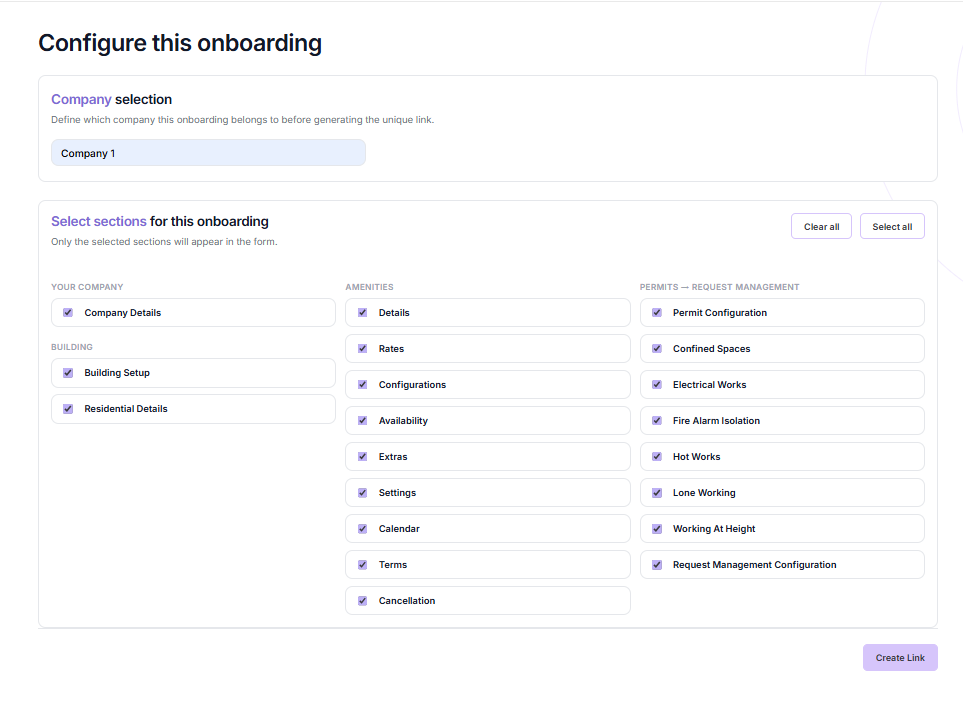

# Updata

Sistema distribuído de onboarding para estruturar a entrada de clientes.

Projeto acadêmico desenvolvido em equipe no Inteli, em parceria com **Equiem**, no período de fev–abr/2026.

## Interface

Tela de configuração de onboarding registrada na documentação, com seleção de empresa e das seções do formulário. A captura utiliza a identificação genérica “Company 1”.

## Contexto e proposta

A entrada de novos clientes envolve coleta, validação e circulação de informações. O Updata busca organizar esse percurso em um fluxo de onboarding mais consistente, reduzindo a dependência de etapas manuais e tornando o andamento mais claro para quem participa do processo.

## Minha participação

Contribuí para uma arquitetura em três camadas com TypeScript, Node.js, PostgreSQL, Auth0 e Docker em AWS. Implementei e validei funcionalidades e testes automatizados no processo de onboarding.

A solução completa é resultado do trabalho coletivo da equipe.

## Pontos técnicos e aprendizados

- **Consistência do fluxo:** validar uma tela isoladamente não garante que o processo completo preserve as informações entre as etapas.
- **Separação de responsabilidades:** a arquitetura em três camadas ajuda a distinguir interface, regras de negócio e persistência, facilitando a evolução e os testes.
- **Da implementação à execução:** autenticação, banco de dados, contêineres e infraestrutura precisam funcionar em conjunto para sustentar a jornada de onboarding.

## Tecnologias

TypeScript · Node.js · PostgreSQL · Auth0 · Docker · AWS · Vitest.

## Sobre este repositório

Este repositório reúne uma apresentação resumida do Updata e da minha participação no desenvolvimento; não contém a documentação completa do projeto. O código-fonte, o histórico e a documentação completa são mantidos privados porque o projeto foi desenvolvido em um ambiente acadêmico controlado do Inteli, em parceria com **Equiem**, respeitando o contexto de compartilhamento dessa colaboração.

Em conversas e processos seletivos, fico à disposição para comentar minha participação, as decisões técnicas e os aprendizados do projeto, apresentar e discutir a documentação completa e demonstrar o código, respeitando os limites de compartilhamento das informações.
